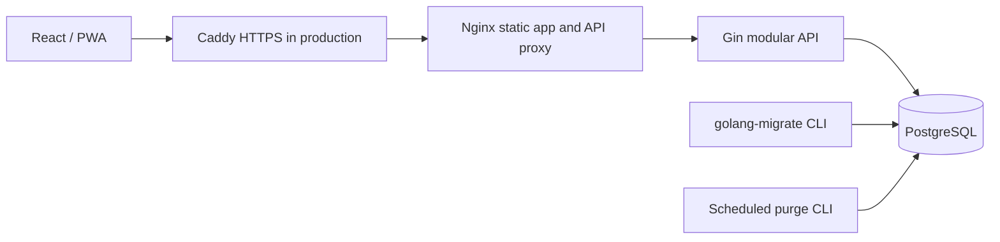

# Devaraj Time

**Smarter Attendance. Fairer Workplaces.**

A working Go/PostgreSQL attendance application with a responsive React workspace. Employees record attendance through permanent printed QR points and fresh location evidence. Company administrators manage workplaces, employees and shifts. Employees can review original events and request corrections; authorized reviewers make traceable decisions.

This release implements the core workflow and selected management modules. It is **not the entire master specification or a production certification**. Read [the exact limitations](docs/limitations.md) before adoption. Dashboard values come from PostgreSQL; only the explicit development seed creates fictional history.

## Local start

Prerequisites: Docker Desktop/Engine running, Docker Compose, and ports 5173, 8080, 5432 available. The first build downloads images and dependencies.

```powershell
Copy-Item .env.example .env
# Edit .env: choose a strong POSTGRES_PASSWORD and DEMO_PASSWORD (12+ characters).
# Keep DATABASE_URL consistent with POSTGRES_PASSWORD for native Go commands.
docker compose up --build -d db
docker compose run --rm --build migrate
docker compose run --rm --build seed
docker compose up --build -d api web
```

Open [Devaraj Time](http://localhost:5173). API readiness is [available through the web proxy](http://localhost:5173/api/health).

The current workspace already has a gitignored `.env` with random local database and demo passwords, migrated and seeded PostgreSQL, and running containers. Do not replace that file if you want to keep these accounts usable. Do not publish or commit it.

Public registration is disabled. Without demo data, bootstrap a platform administrator using the `bootstrap-admin` CLI and private `PLATFORM_ADMIN_EMAIL` / `PLATFORM_ADMIN_PASSWORD` environment variables. That administrator provisions company owners through Platform administration. Set real workplace coordinates and company-specific rules before recording attendance. See [the system update guide](docs/system-update.md) for enrollment, SMTP, scheduling, provisioning and test instructions.

## Demo accounts

Two independent fictional companies are provisioned explicitly in development:

| Role | Lotus Studio | Riverstone Academy |
| --- | --- | --- |
| Administrator | admin@lotus.example | admin@riverstone.example |
| HR | hr@lotus.example | hr@riverstone.example |
| Department manager | manager@lotus.example | manager@riverstone.example |
| Employee | employee@lotus.example | employee@riverstone.example |

Additional accounts are `employee2` and `employee3` at each demo domain. Only Administrator and HR use password login; employees and department managers require HR-issued passkey enrollment. Administrative demo passwords come from local **DEMO_PASSWORD**. The development platform administrator is `platform@devaraj.example` using that same local demo password. The seed refuses to run outside development and does not overwrite existing credentials. Profile → Change password revokes all sessions.

Seed workplaces use fictional Phnom Penh coordinates. The location check will reject you elsewhere. **Edit the workplace to your actual testing coordinates**; there is no production GPS bypass. The seed labels raw historical events `development_seed`.

## What works

- Platform-only company provisioning, authorized active-company selection, activation/subscription management, role checks and department-scoped managers.
- Invitation-only employee passkeys, revocation/replacement, and a phone-camera QR attendance page with automatic check-in/out and short-repeat suppression.
- SMTP password recovery with expiring one-use tokens, verified recovery destinations and session revocation.
- HR/Admin individual and bulk effective-dated schedules, daily rotations, rest days, temporary overrides and immutable assignment history.
- Argon2id passwords, random opaque session cookies, CSRF plus exact Origin checks, expiry, logout, password change and session revocation.
- Employee creation, assignments, activation/deactivation, paginated directory and edit actions with reasons; branch and department creation/editing.
- Configurable shifts, workdays, grace periods, overnight work dates, elapsed-time calculations across daylight saving, breaks, expected minutes and overtime eligibility.
- Workplaces with coordinates, branch assignment, geofence radius, location requirement, accuracy threshold and activation.
- Permanent QR points, PNG/SVG downloads, print sheets, disabling and identifier rotation.
- Browser camera scanning, supported flashlight control, printed URL/identifier fallback, fresh geolocation and explicit confirmation.
- Transactional check-in, check-out, start/end break, authoritative database timestamps, invalid-transition prevention, idempotent retries and concurrent duplicate protection.
- Immutable original events, retained policy snapshots, employee history/details, organization dashboard, actual historical trend chart and polling.
- Correction submission, cancellation, non-self approval/rejection, separate immutable decisions and derived summary recalculation.
- Full-day leave requests and review, overlap/conflict checks and dashboard integration.
- In-app attendance/request notifications, read state, audit trail, CSV/XLSX attendance exports and formula injection protection.
- Separate private location evidence with an explicit retention purge command.
- Responsive light/dark interface, accessible dialogs, keyboard controls, PWA manifest/icons and an informational offline screen. Sensitive API responses are never service-worker cached.

## Architecture and repository

The application is a modular Go monolith using Gin, pgx parameterized SQL, golang-migrate, slog and PostgreSQL. Typed request/identity/policy structures and explicit SQL replace sqlc generation in this version. React uses TypeScript, Vite, Tailwind, shadcn-style Radix primitives, React Router, TanStack Query, React Hook Form, Zod, Lucide, Recharts, ZXing and qrcode. Lockfiles pin resolved dependency versions. Production Go images use 1.27.2; native validation was upgraded to Go 1.27.2 after the vulnerability scan.

```text
Devaraj/
├── backend/
│   ├── cmd/api/main.go           # serve / migrate / seed / purge-location
│   ├── internal/
│   │   ├── attendance/           # deterministic policy, state and geofence functions
│   │   ├── auth/                 # Argon2id, random tokens and digests
│   │   ├── database/             # precise-location retention
│   │   ├── seed/                 # explicit fictional demo provisioning
│   │   └── server/               # authenticated HTTP modules and DB integration tests
│   ├── migrations/              # reversible versioned SQL
│   ├── go.mod / go.sum
│   └── Dockerfile
├── frontend/
│   ├── src/
│   │   ├── components/           # accessible UI and account controls
│   │   ├── lib/                  # API client and QR validation tests
│   │   ├── pages/                # administration, scan, history and requests
│   │   ├── App.tsx / main.tsx / styles.css
│   ├── public/                  # manifest, original brand icons, service worker, offline page
│   ├── e2e/                     # Playwright workflow test
│   ├── playwright.config.ts
│   ├── package.json / package-lock.json
│   ├── nginx.conf / Dockerfile
├── docs/                        # architecture, API, rules, security, operations and gaps
├── scripts/                     # reproducible icons, OpenAPI and PowerShell tooling
├── docker-compose.yml / docker-compose.prod.yml / Caddyfile
├── .env.example / .gitignore / Makefile
├── IMPLEMENTATION.md
└── README.md
```



See [architecture](docs/architecture.md) and [database relationships](docs/database.md).

## Native development

Install a compatible Go 1.27 release and Node.js 24. Start PostgreSQL with Docker as above, then load `.env` into your shell. PowerShell helpers load it without printing secrets:

```powershell
./scripts/backend.ps1 migrate
./scripts/backend.ps1 seed
./scripts/backend.ps1 serve
# In another terminal:
cd frontend
npm ci
npm run dev
```

Vite proxies `/api` to `localhost:8080`. **PUBLIC_URL must be the exact browser origin without a trailing slash**, normally `http://localhost:5173`. Cookies and CSRF rely on a same-origin API proxy. Do not expose a separate permissive CORS API.

## QR and employee testing

1. Sign in as administrator. Configure the company timezone, workdays and shift times for your actual work policy.
2. Create a branch, department and shift as needed. Create an employee with a new email, private initial password, branch and shift.
3. Create/edit a workplace with real latitude/longitude, reasonable radius and acceptable reported GPS error. Keep location required for a geofenced attendance test.
4. Create a QR point assigned to that workplace. Use **View & print** to preview, download PNG/SVG or print. The URL contains no employee/session credentials.
5. Sign in as the employee on a compatible mobile browser. Camera and location require **HTTPS** on phones; localhost is only a secure-context exception on the same device. A phone opening `http://<laptop-IP>:5173` may be unable to use camera/GPS. Configure a real HTTPS test origin; see deployment.
6. Scan the printed code, or open its attendance URL. Confirm check-in. The API validates active membership, assigned branch, active point/workplace, shift/workday, fresh GPS, accuracy, boundary and attendance state.
7. Verify server-confirmed time and personal details. HR can see the scoped record in Attendance. Record breaks and check-out through the same point.
8. For a correction, submit a work date, proposed past check-in/out interval and reason. Sign in as a different authorized HR/admin reviewer, approve with a reason, and revisit the employee record. The summary identifies the adjustment; original events remain unchanged.
9. Rotate a QR point and confirm its old printed URL stops resolving. Test outside-radius and denied-location cases; rejected scans never become successful attendance.

QR + browser GPS is layered deterrence and evidence, **not proof of physical presence**. No employee location is tracked continuously. An unavailable location offers a correction/exception path instead of declaring absence.

## Calculations and roles

[Attendance rules](docs/attendance-rules.md) define all calculations and supported statuses. Lateness is `max(0, floor(arrival delay minutes) − grace minutes)`; actual arrival delay is stored separately. Worked time uses UTC elapsed duration, subtracts recorded breaks and any separately configured fixed deduction. Historical records use their stored policy snapshot.

Owners/admins configure resources and roles. HR manages employee-role accounts, reviews requests and exports reports. Managers read/review their assigned department and their own records; a manager with no department does not gain organization access. Employees access their own records and submit personal requests. No reviewer can approve their own request. Platform-super-admin operations and custom role configuration are not implemented.

## Tests

```powershell
./scripts/backend.ps1 test         # unit + isolated-schema PostgreSQL integration tests
./scripts/backend.ps1 vet
cd frontend
npm test
npm run build
npx playwright test              # local Docker app must be running; uses installed Chrome
```

Integration tests require TEST_DATABASE_URL. The helper uses the local DATABASE_URL by default; it creates a random schema and drops only that schema after testing. **Never point tests at a production database.** Playwright uses fictional accounts in a visibly named `E2E workspace …` tenant, actual HTTP/backend/database writes and browser-only simulated GPS. It leaves those development tenants for inspection. No mock clock or GPS bypass exists in production endpoints.

Recorded validation and untested scenarios are in [verification](docs/verification.md). Do not interpret passing tests as a security audit or employment/privacy-law compliance.

## Deployment and operations

[Deployment instructions](docs/deployment.md) cover Caddy HTTPS, production environment, least-privilege database roles, migration/backup/restore and retention scheduling. Use `docker-compose.prod.yml` **together with** the base file. Never run seed against production. Back up before migrations and test restores.

```powershell
docker compose -f docker-compose.yml -f docker-compose.prod.yml up --build -d db
docker compose -f docker-compose.yml -f docker-compose.prod.yml run --rm migrate
docker compose -f docker-compose.yml -f docker-compose.prod.yml up --build -d api web caddy
```

Supply a real DOMAIN, ACME_EMAIL and production credentials first. Production API startup rejects insecure cookies and non-HTTPS origins. Public deployments require a separate product/security/legal review and resolution of the limitations below.

## Documentation and next work

- [OpenAPI 3.1 contract](docs/openapi.json) and [API guide](docs/api.md)
- [Database](docs/database.md), [architecture](docs/architecture.md), [attendance rules](docs/attendance-rules.md)
- [Security](docs/security.md), [privacy notice template](docs/privacy-notice.md)
- [Deployment](docs/deployment.md), [user guide](docs/user-guide.md)
- [Known limitations and prioritized roadmap](docs/limitations.md), [implementation checklist](IMPLEMENTATION.md)

Recovery/enrollment and effective-dated scheduling are implemented in this update. Next priorities include stable-domain and SMTP deployment, real iPhone QA, administrative MFA/initial password changes, absence evaluation, holiday/flexible schedules, storage/leave balances, independent security review and production operating validation.

