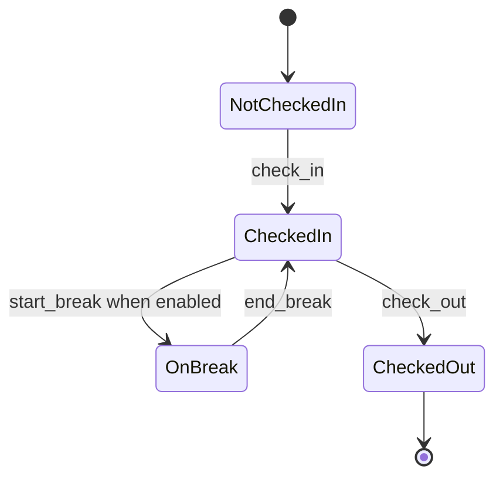
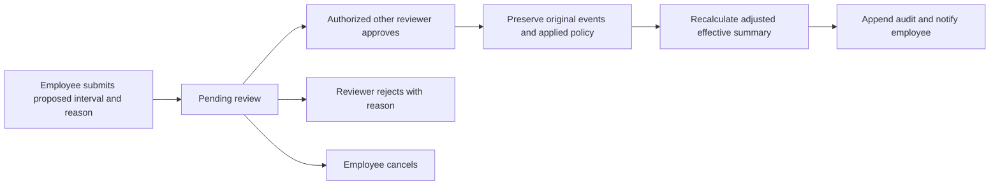

# Attendance rules

## State and confirmation

An employee can have at most one open session and one summary per work date. Checkout while on break is rejected; end the break first. Reopening a checked-out work date is not supported. No client-provided time becomes an authoritative event time. A decoded QR alone creates no attendance record.

The permanent QR identifier is 32 random bytes encoded as 43 URL-safe characters. It is public routing information, not an authorization secret. Only a registered point in the employee's current active company and assigned branch can be used. Point/workplace/membership activation is checked server-side. Rotation replaces the public identifier immediately.

## GPS

The server accepts a location reading no older than 90 seconds and no more than 10 seconds in the future, requiring valid finite coordinates and positive reported accuracy. Accuracy means reported error radius in meters; greater than the configured maximum is rejected. Distance is Haversine on a 6,371,000 m Earth sphere. A distance exactly at the configured radius is accepted; greater is rejected. Accuracy is a separate threshold and is not added to the geofence radius.

All failures return a clear rejection, not an attendance event or verified absence. Coordinates are evidence provided by the browser and can be spoofed. No weak signal is labeled fraud or GPS spoofing. No continuous tracking exists.

## Work dates and time

Times are stored as UTC instants. Shift boundaries use IANA local calendar dates and HH:mm values. End at or before start denotes the next calendar day. Overnight readings before the next start minus the early window are associated with the preceding shift work date; a new check-in after that shift's end is rejected. Existing open sessions retain their original date and policy across midnight. Elapsed worked time uses actual UTC elapsed seconds, including daylight saving changes.

Ambiguous/nonexistent wall times at daylight saving transitions currently use Go's timezone resolution. There is no explicit fold selector or configurable gap policy; avoid assigning those shift boundaries until a company-specific policy is implemented and tested.

Workdays use Go weekday numbers: Sunday 0 through Saturday 6. Check-in on a rest day, before the early window, after shift end, without a shift or on approved full-day leave is rejected with an exception-request path. Holidays, flexible shifts, split shifts, early-departure grace and effective-date overrides are not supported.

## Calculation

- Actual arrival delay: `max(0, floor((check_in − scheduled_start) / minute))`.
- Late beyond grace: `max(0, actual_arrival_delay − grace_minutes)`.
- Status: `on_time` if at/before start; `within_grace` if later with zero late minutes; `late` otherwise.
- Worked: `max(0, floor((effective_checkout − effective_checkin − recorded_break_seconds) / minute) − fixed_unpaid_break_minutes)`.
- Early departure: `max(0, floor((scheduled_end − effective_checkout) / minute))`.
- Overtime: when enabled, `max(0, worked_minutes − expected_minutes)`; otherwise zero.

Recorded and fixed breaks are separate deductions. Set fixed deduction to zero if recorded breaks should be the only deduction. Seed records contain explicit hour-long breaks; seed shifts have no additional fixed deduction. An open session has no completed worked-minute calculation; UI labels worked values as calculated at checkout. Attendance outcome status is separate from state (`checked_in`, `on_break`, `checked_out`).

No automatic verified absence, missing-checkout cutoff or pending-verification evaluator runs. Dashboard **No record yet** counts active scoped memberships without today's summary or approved leave and includes unscheduled staff. It must not be used as an absence count. Attendance cards can overlap: late is an arrival attribute, currently-working is a live state. Active/open overnight sessions may not appear in the current-calendar-date organization cards, while the employee scanner resolves the open session. See limitations.

## Corrections and leave

Corrections require a single work date within the configured deadline, a past interval no longer than 24 hours, correct shift work date and a reason of at least 10 characters. An authorized approval can close an open session for a forgotten checkout without fabricating a raw scan. An open break is ended at the approved effective checkout for calculation, and a proposed checkout preceding that break is rejected. Existing sessions use their original policy and break duration. Missing-session corrections use the current assigned shift snapshot, not an unimplemented historical assignment system. Approved corrections do not create simulated raw scans. Requested values become approved effective values without reviewer edits. Decisions are immutable and self-review is forbidden.

Leave covers full inclusive dates. Approval rejects existing attendance or overlapping approved leave. On-leave dashboard counts come from approved requests. Leave is not synthesized into an attendance session and is not included in attendance-summary exports. No statutory entitlement, paid amount, balance or overtime-pay multiplier is assumed.

