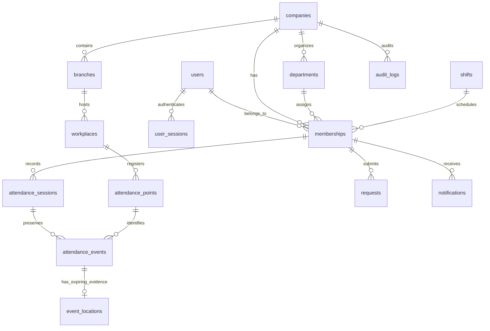

# Database

Apply migrations using golang-migrate through the API CLI. Migration 1 creates the normalized core. Migration 2 separates expiring location evidence from immutable clock events. Migration rollback cannot resurrect erased location data. Do not roll back a live system without a reviewed recovery plan and backup.

Migration 3 adds invitation-only WebAuthn credentials, revocable credential-backed sessions, password-recovery tokens, platform administration/audit, company activation and immutable effective-dated schedules. Migration 4 constrains verified recovery addresses to be unique. Migration 5 adds bounded platform enrollment configuration. All preserve existing core records; see [the update guide](system-update.md).

Composite company/resource foreign keys protect department, branch, shift, workplace, point, membership/session and private location assignments. User account identity is global; memberships represent employment and access within a company. One membership per user/company, one employee code per company, one summary per employee work date, one open session per employee, and one idempotency key per employee are enforced by unique constraints/indexes.

Raw attendance events and audit rows reject UPDATE and DELETE through database triggers. Decided requests reject further UPDATE. Correction decisions remain separate from effective summary columns. These controls do not defend against database owners or administrators disabling triggers or altering the schema. Production runtime privileges must additionally exclude UPDATE/DELETE on raw events and audit logs; see deployment.

Precise locations are inaccessible through public point resolution and ordinary attendance detail responses. The evidence table is separate so a retention job can erase it without changing original timestamps/action/verification. The idempotency request digest remains, but contains no recoverable plaintext payload. Retention does not erase users, raw events, audit history, request reasons or backups; their lifecycle requires jurisdiction/company-specific administration.

All authoritative event timestamps use `timestamptz` and are generated from `clock_timestamp()` in PostgreSQL after locking. Work dates are anchored to company IANA timezone and shift start. Existing policy JSON snapshots store version, timezone, shift name, boundaries, grace, expected duration, fixed break deduction, early window, overtime/break flags and workdays.
